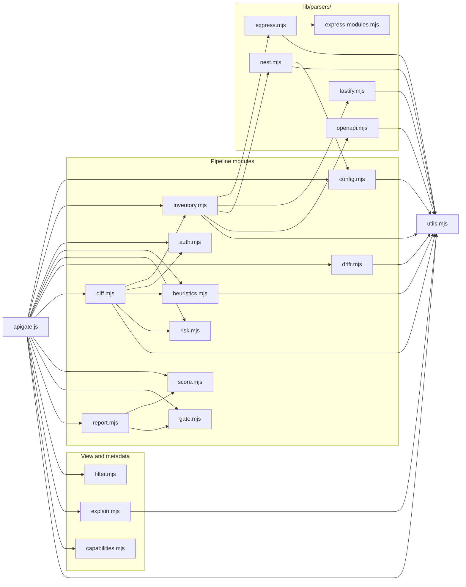
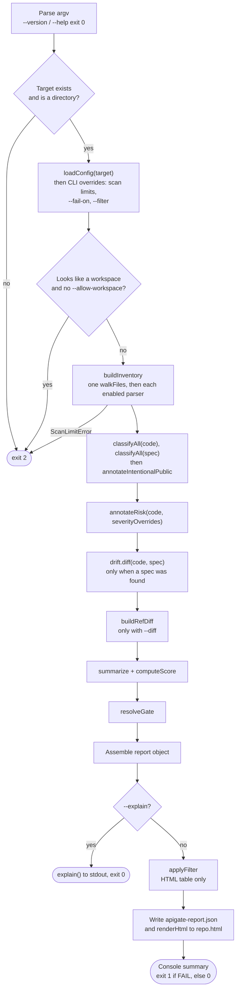
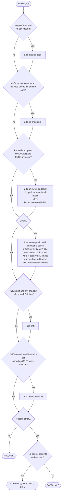

# ApiGate architecture

This document describes how ApiGate is built: the modules, the order in which
they run, how the score and the CI gate are computed, and what keeps the
output deterministic. Usage, flags and configuration are in
[README.md](README.md). The free/paid boundary is in
[OPEN-CORE.md](OPEN-CORE.md).

## System at a glance

ApiGate is a Node.js (>= 20) ES-module CLI. It reads files under one target
directory, never runs them, and makes no network calls.

- **Input:** source files (Express, Fastify, NestJS), OpenAPI 2.0 / 3.x specs,
  an optional `.apigate.config.json` in the target, CLI flags, and an
  optional git ref for `--diff`.
- **Output:** `apigate-report.json`, a single-file `<repo-name>.html`
  rendered by `@stelnyx/report-theme`, a console summary, and an exit code
  (`0` pass or nothing analysed, `1` gate failed, `2` CLI or scan error).
- **Runtime dependencies:** `acorn` and `acorn-walk` (JavaScript AST),
  `yaml` (OpenAPI YAML), `@stelnyx/report-theme` (HTML shell).

The whole run is one synchronous pass in [`apigate.js`](apigate.js) over
plain functions and plain objects in `lib/`. Only `lib/diff.mjs` starts a
subprocess (local `git`), and only with `--diff`.

## Module map

| Module | Role |
|---|---|
| [`apigate.js`](apigate.js) | CLI entry. Parses argv, applies CLI overrides to config, runs the pipeline, writes reports, prints the summary, maps gate status to the exit code. Also holds `summarize()` and the workspace guard `detectWorkspace()`. |
| [`lib/config.mjs`](lib/config.mjs) | `CONFIG_DEFAULTS` and `loadConfig(target)`. Reads `.apigate.config.json`, keeps only keys with the expected type, falls back to defaults on invalid JSON. |
| [`lib/utils.mjs`](lib/utils.mjs) | Bounded, sorted file walk (`walkFiles`, `ScanLimitError`), size-capped `readTextFile`, `compileGlob`, `normalizePath` / `normalizeMethod`, `sortEndpoints`, `relPath`. |
| [`lib/inventory.mjs`](lib/inventory.mjs) | `buildInventory`. One file walk shared by all enabled parsers; splits code endpoints from spec endpoints; dedups and sorts both. |
| [`lib/parsers/express.mjs`](lib/parsers/express.mjs) | Express routes. acorn AST for `.js/.mjs/.cjs`, regex fallback for `.ts/.tsx`. Router variable tracking, same-file mounts, `route()` chains, path-less `use()` markers. |
| [`lib/parsers/express-modules.mjs`](lib/parsers/express-modules.mjs) | Cross-file Express mount resolution. Links exported routers to `X.use(prefix, ...mw, router)` calls by relative import specifier and rewrites route paths. |
| [`lib/parsers/fastify.mjs`](lib/parsers/fastify.mjs) | Fastify routes. acorn AST for `.js/.mjs/.cjs`, bounded text scanner for TypeScript. `fastify.<method>()` and `fastify.route({...})`. |
| [`lib/parsers/nest.mjs`](lib/parsers/nest.mjs) | NestJS controllers via decorator extraction (no TS AST). Class and method guards, global guards, literal `setGlobalPrefix()`, `publicDecorators`. |
| [`lib/parsers/openapi.mjs`](lib/parsers/openapi.mjs) | OpenAPI 2.0 / 3.x specs in YAML or JSON. Derives `declaredPosture` from operation and root `security`. |
| [`lib/auth.mjs`](lib/auth.mjs) | `classifyAll`. Sets `posture` (`GUARDED` / `OPEN` / `UNKNOWN`) and `matchedAuthMarker` from `config.auth.<framework>`. |
| [`lib/heuristics.mjs`](lib/heuristics.mjs) | `DEFAULT_PUBLIC_AUTH_PATTERNS` (49 exact method + path pairs) and `annotateIntentionalPublic`. |
| [`lib/risk.mjs`](lib/risk.mjs) | Per-endpoint `risk` (`HIGH` / `MED` / `LOW`) and `riskReason`, with `severityOverrides`. |
| [`lib/drift.mjs`](lib/drift.mjs) | Code vs spec diff: `shadow`, `stale`, `authDrift`. |
| [`lib/diff.mjs`](lib/diff.mjs) | `--diff <ref>`. Checks out the ref in a temporary git worktree, reruns inventory, auth, heuristics and risk there, and diffs endpoint lists. |
| [`lib/score.mjs`](lib/score.mjs) | Five 0-100 rubrics, the headline mean, and score bands. |
| [`lib/gate.mjs`](lib/gate.mjs) | `resolveGate` (status and sorted `reasons`), `parseFailOnFlag`, `GATE_REASONS`, `NOTHING_ANALYSED_NOTICE`. |
| [`lib/capabilities.mjs`](lib/capabilities.mjs) | Frozen `PARSER_CAPABILITIES`, `RISK_TIER_INFO`, `KNOWN_UNRESOLVED_REASONS`, embedded in every report. |
| [`lib/filter.mjs`](lib/filter.mjs) | `--filter` grammar. Narrows the HTML endpoint table only. |
| [`lib/explain.mjs`](lib/explain.mjs) | `--explain <method> <path>`. Formats one endpoint's evidence chain for stdout. |
| [`lib/report.mjs`](lib/report.mjs) | `LIMITATIONS` text and `renderHtml`, built only from `@stelnyx/report-theme` primitives (see [DESIGN_PARITY.md](DESIGN_PARITY.md)). |

## Module dependencies

Built from the `import` statements in `apigate.js` and `lib/`. Node
built-ins and npm packages are left out (`acorn`, `acorn-walk`, `yaml`,
`@stelnyx/report-theme`; see the module map).

`auth`, `risk`, `score`, `gate`, `capabilities` and `filter` import nothing;
`nest.mjs` imports `config.mjs` only for the default `publicDecorators`.

## Pipeline

The call order in `apigate.js`, from argv to exit code:

Notes on the steps:

1. **Inventory.** `buildInventory` walks the target once for
   `.js .mjs .cjs .ts .mts .cts .tsx .yaml .yml .json` and hands the sorted list to each
   parser enabled in `config.frameworks`. Express endpoints are kept only if a
   scanned file imports or requires `express` or the root `package.json`
   declares it. If no code endpoint is found, each framework declared in
   `package.json` adds a `framework-detected-no-endpoints` warning.
2. **Auth.** OpenAPI endpoints take the posture the parser derived from
   `security`. An unresolved code endpoint is `UNKNOWN`. Otherwise the first
   `authMarkers` entry found in `config.auth.<framework>` makes it `GUARDED`
   (a dotted identifier such as `passport.authenticate` also matches its last
   segment); no match is `OPEN`.
3. **Intentional public.** Endpoints matching `publicAuthPatterns` (or the
   built-in list, unless `strictPublic` is on) get `intentionalPublic: true`.
   Their posture does not change.
4. **Risk, drift, ref diff, score, gate.** See the next sections. Drift runs
   only when a spec endpoint exists. `--filter` affects only the HTML table;
   `summary`, `gate`, score and the JSON report always use the full scan.

## Scoring

From [`lib/score.mjs`](lib/score.mjs), rubric version `v1`. Only code
endpoints are scored.

| Rubric | Formula |
|---|---|
| `inventoryResolved` | `round(100 × resolved / total)` |
| `authCoverage` | `round(100 × guarded / counted)`, where `counted` is every endpoint that is not intentional-public. `UNKNOWN` counts against coverage. 100 if `counted` is empty. |
| `openEndpointRisk` | `100 − 12 × open writes − 3 × open reads`, clamped to 0..100. Intentional-public endpoints are skipped. Writes are `POST PUT PATCH DELETE`. |
| `specDrift` | `100 − 5 × shadow − 5 × stale − 10 × authDrift`, clamped to 0..100. `null` when no spec was found. |
| `determinism` | Always 100. Byte-equality is enforced by tests, not by this number. |

`headlineScore = round(mean of the non-null rubrics)`. Bands from
`bandFromScore`: `STRONG ≥ 85`, `GOOD ≥ 70`, `MIXED ≥ 50`, `WEAK < 50`.
With zero code endpoints, `headlineScore` and every rubric are `null`.

## Risk tiers

From [`lib/risk.mjs`](lib/risk.mjs), version `v1`. A path is sensitive if
its lowercased text contains one of 9 tokens: `admin`, `auth`, `billing`,
`delete`, `internal`, `password`, `secret`, `token`, `users`.

| Posture | Write method | Read method |
|---|---|---|
| intentional-public | LOW | LOW |
| `OPEN` | HIGH | MED on a sensitive path, else LOW |
| `UNKNOWN` | MED | LOW |
| `GUARDED` | MED on a sensitive path, else LOW | LOW |

A `severityOverrides` entry with the exact method and path replaces the tier
and sets `riskReason` to the entry's `reason` (or `"user override"`).

## CI gate and exit codes

From [`lib/gate.mjs`](lib/gate.mjs). `resolveGate` collects reason codes into
a set, sorts them, and returns `{ status, reasons }`. The CLI exits `1` only
when `status` is `FAIL`.

Default `failOn` in `CONFIG_DEFAULTS`: `openWriteMethods: true`,
`newOpenWrite: true` (only acts with `--diff`), everything else `false`.
`requireSpec` defaults to `false`. `--fail-on` can only turn checks on; an
unknown token exits `2`. Exit `2` also covers a missing target, an invalid
flag value, a scan limit hit, a failed `--diff`, and a report write error.

## Supported frameworks

| Framework | Files read by the CLI scan | Method |
|---|---|---|
| Express | `.js .mjs .cjs` (AST), `.ts .tsx` (regex) | acorn + acorn-walk |
| Fastify | `.js .mjs .cjs` (AST), `.ts .mts .cts` (text scanner) | acorn + bounded scanner |
| NestJS | `.ts .tsx .js .mjs` | decorator regex extraction |
| OpenAPI | `.yaml .yml .json` with a `swagger:` or `openapi:` root | `yaml` / `JSON.parse` |

What each parser does and does not resolve is listed in
`PARSER_CAPABILITIES` ([`lib/capabilities.mjs`](lib/capabilities.mjs)) and
in the README [Frameworks](README.md#frameworks) section.

### Adding a parser

Follow the existing parsers; `lib/parsers/fastify.mjs` is the smallest code
parser.

1. Create `lib/parsers/<name>.mjs` exporting
   `parse<Name>(targetDir, excludePaths = [], scanOptions = {}, candidateFiles = null)`.
   When `candidateFiles` is `null`, call `walkFiles`; otherwise use
   `filterFilesByExtension(candidateFiles, EXTS)`. Read files with
   `readTextFile(file, scanOptions.maxFileBytes)` and emit a `file-too-large`
   warning when it skips one. Return `{ endpoints, warnings }`.
2. Emit endpoints in the [shape below](#key-data-types). A path that is not a
   static string gets `resolved: false` and an `unresolvedReason`; never guess.
   Add any new reason to `KNOWN_UNRESOLVED_REASONS`.
3. Wire it into `buildInventory` in `lib/inventory.mjs` behind
   `fw.<name>`, and add new file extensions to `CANDIDATE_EXTENSIONS`.
4. In `lib/config.mjs`, add the toggle to `CONFIG_DEFAULTS.frameworks` and to
   the key list in `mergeFrameworks`, and default identifiers to
   `CONFIG_DEFAULTS.auth.<name>` and the key list in `mergeAuth`.
5. Add a `PARSER_CAPABILITIES.<name>` entry, the framework value in
   `ALLOWED_VALUES.framework` in `lib/filter.mjs`, and the name in the
   `--help` text.
6. Add a fixture under `test/fixtures/<name>-app/` and `test/parser-<name>.mjs`,
   and append it to the `test` script in `package.json` (each suite is listed
   by name).
7. Update the README Frameworks table and `CHANGELOG.md`.

## Determinism and zero network

**Determinism.** With the same files, config, ApiGate version and
`APIGATE_TIMESTAMP`, the JSON and HTML are byte-identical. The mechanisms:

- `walkFiles` sorts directory entries by code point (not locale) and skips symlinks.
- `sortEndpoints` is a total order (method, path with `null` last, file, line).
  Drift, ref-diff and gate reason lists are sorted too.
- Rules and tables are frozen constants (`Object.freeze`). The score and
  risk rules carry version strings (`rubricVersion`, `riskVersion`) in the
  report.
- The report timestamp is the only clock value in the output. Set
  `APIGATE_TIMESTAMP` in CI. `--strip-paths` (on when `CI=true`) replaces the
  absolute target with its basename.
- `--diff` resolves the ref to a full SHA and reports `baseSha`.

[`test/determinism.mjs`](test/determinism.mjs) runs inventory, classify,
drift, score, risk, filter and the HTML renderer twice on
`test/fixtures/sample-app` and compares bytes. It also checks that
cross-file Express mounts give the same output for forward and reversed file
lists. [`test/scan-safeguards.mjs`](test/scan-safeguards.mjs) covers the scan
bounds: the workspace guard, `--allow-workspace`, `--max-files`, the single
shared file walk, and identical endpoint keys with and without the shared
index.

**Zero network.** No file in `apigate.js` or `lib/` imports `http`,
`https`, `net` or `fetch`. The only subprocess is `git` in `lib/diff.mjs`
(`rev-parse`, `worktree prune|add|remove`), run with `--diff` against a
worktree in the OS temp directory. The HTML report inlines its CSS and script
and makes no external requests: `lib/report.mjs` passes `skipInterFont: true`
to the theme shell, and [`test/report-theme-contract.mjs`](test/report-theme-contract.mjs)
fails on Google Fonts hosts or any external `http(s)` URL in `<link>`,
`<script>`, `@import` or `url()`. No test blocks network access at runtime;
the guarantee rests on the import surface and the four-package dependency
list ([SECURITY.md](SECURITY.md)).

## Testing layout

There is no test framework. Each suite is a plain Node script using
[`test/_runner.mjs`](test/_runner.mjs) and exits non-zero on failure.
Fixtures live in `test/fixtures/`.

| Script | Runs |
|---|---|
| `npm test` | All 20 suites in sequence |
| `npm run test:parsers` | `parser-express`, `parser-fastify`, `parser-nest`, `parser-openapi` |
| `npm run test:auth` / `test:drift` / `test:score` / `test:config` / `test:gates` | One suite each |
| `npm run test:golden` | `golden-apigate.mjs`: fixed counts, postures, drift and headline for `sample-app` |
| `npm run test:determinism` / `test:contract` | `determinism.mjs`; `report-theme-contract.mjs` (HTML comes from the theme shell) |
| `npm run lint` | ESLint, including a rule that rejects `<!doctype` literals outside `lib/report.mjs` |

Suites without a shortcut (`risk`, `diff`, `filter`, `explain`, `gate`,
`capabilities`, `heuristics`, `scan-safeguards`) run with `node test/<name>.mjs`.
CI runs `npm ci`, `npm run lint`, `npm test`, then scans the repo itself.

## Key data types

**Endpoint** (emitted by parsers, extended by later stages):

| Field | Set by | Values |
|---|---|---|
| `method` | parser | `GET POST PUT PATCH DELETE OPTIONS HEAD ALL`, OpenAPI also `TRACE`; `UNKNOWN` when unreadable |
| `path` | parser | string, or `null` when unresolved |
| `file`, `line` | parser | path relative to the target; `line` is `null` for OpenAPI |
| `framework` | parser | `express`, `fastify`, `nest`, `openapi` |
| `resolved`, `unresolvedReason` | parser | boolean; one of `KNOWN_UNRESOLVED_REASONS` or `null` |
| `authMarkers` | parser | sorted identifier names from middleware or decorators |
| `declaredPosture` | OpenAPI parser | internal, removed before the JSON is written |
| `posture`, `matchedAuthMarker` | `auth.mjs` | `GUARDED`, `OPEN`, `UNKNOWN`; first matching identifier or `null` |
| `intentionalPublic` | `heuristics.mjs` | boolean |
| `risk`, `riskReason` | `risk.mjs` | `HIGH`, `MED`, `LOW`; rule text (code endpoints only) |

**Other shapes.** Inventory (`buildInventory`):
`{ code, spec, warnings, frameworksDetected, specsDetected }`. RefDiff
(`buildRefDiff`): `{ baseRef, baseSha, added, removed, changedPosture, changedRisk }`.
Gate (`resolveGate`): `{ status: "PASS" | "FAIL" | "NOTHING_ANALYSED", reasons }`,
with `reasons` drawn from `GATE_REASONS`. Drift (`drift.diff`):
`{ shadow, stale, authDrift }`, each item `{ kind, method, path, note }`, where
`kind` is `shadow`, `stale`, `authDriftDeclaredOnly` (spec guarded, code open)
or `authDriftCodeOnly` (code guarded, spec open or unknown).

**Config** (`loadConfig`): `frameworks`, `auth`, `failOn`, `excludePaths`,
`severityOverrides`, `publicAuthPatterns`, `publicDecorators`, `requireSpec`,
`strictPublic`, `scan` (`maxFiles` 20000, `maxDepth` 30, `maxFileBytes`
1048576, `timeoutMs` 30000). The full JSON report layout is in the README
[JSON schema](README.md#json-schema) section.

## Related documents

[README.md](README.md) (usage, flags, configuration, report format),
[CONTRIBUTING.md](CONTRIBUTING.md) (setup, PR checklist, releases),
[DESIGN_PARITY.md](DESIGN_PARITY.md) (the `@stelnyx/report-theme` contract),
[SECURITY.md](SECURITY.md) (vulnerability reporting, supply chain),
[OPEN-CORE.md](OPEN-CORE.md) (what stays MIT and free),
[CHANGELOG.md](CHANGELOG.md) (release history).
